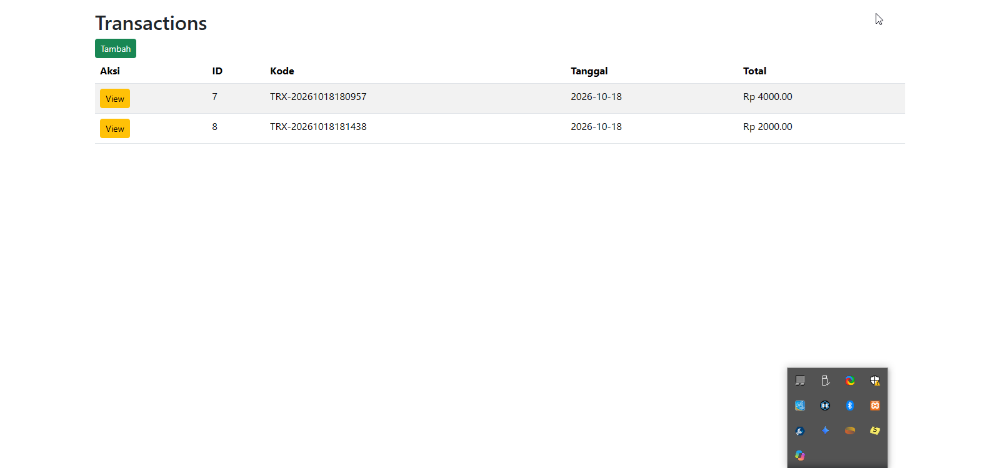
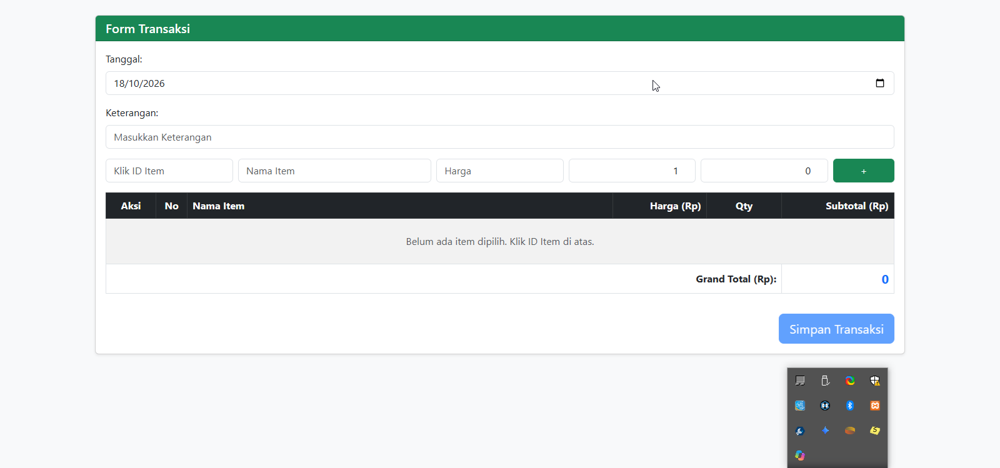
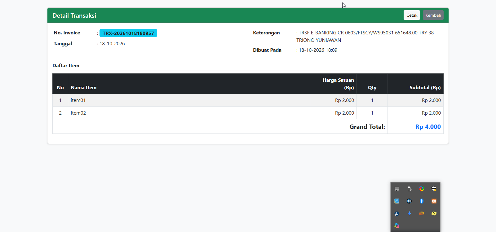

# Pertemuan 6: Implementasi Modul Transaksi (Laravel)

Dokumen ini berisi panduan dan kode sumber lengkap untuk pembuatan sistem transaksi pada aplikasi Laravel, mencakup skema basis data, rute, controller, dan tampilan (views).

---

## 1. Antarmuka Aplikasi (Screenshots)

### Halaman Daftar Transaksi (`/transactions`)


### Halaman Form Tambah Transaksi (`/transactions/create`)


### Halaman Detail Transaksi (`/transactions/show/{id}`)


---

## 2. Step 1: Buat Tabel Database

Berikut adalah skrip SQL untuk membuat tabel `items`, `transactions`, dan `transaction_details`:

```sql
CREATE TABLE `items` (
  `id` bigint(20) UNSIGNED NOT NULL AUTO_INCREMENT,
  `name` varchar(255) NOT NULL,
  `description` text DEFAULT NULL,
  `price` decimal(12,2) NOT NULL,
  `stock` int(11) NOT NULL,
  `created_at` timestamp NULL DEFAULT NULL,
  `updated_at` timestamp NULL DEFAULT NULL,
  PRIMARY KEY (`id`)
) ENGINE=InnoDB DEFAULT CHARSET=utf8mb4 COLLATE=utf8mb4_unicode_ci;

CREATE TABLE `transactions` (
  `id` bigint(20) UNSIGNED NOT NULL AUTO_INCREMENT,
  `invoice_number` varchar(255) NOT NULL,
  `description` varchar(200) DEFAULT NULL,
  `transaction_date` date NOT NULL,
  `total_amount` decimal(12,2) NOT NULL,
  `created_at` timestamp NULL DEFAULT NULL,
  `updated_at` timestamp NULL DEFAULT NULL,
  PRIMARY KEY (`id`)
) ENGINE=InnoDB DEFAULT CHARSET=utf8mb4 COLLATE=utf8mb4_unicode_ci;

CREATE TABLE `transaction_details` (
  `id` bigint(20) UNSIGNED NOT NULL AUTO_INCREMENT,
  `id_transaction` bigint(20) UNSIGNED NOT NULL,
  `item_id` bigint(20) UNSIGNED NOT NULL,
  `price` decimal(12,2) NOT NULL,
  `quantity` int(11) NOT NULL,
  `subtotal` decimal(12,2) NOT NULL,
  `created_at` timestamp NULL DEFAULT NULL,
  `updated_at` timestamp NULL DEFAULT NULL,
  PRIMARY KEY (`id`)
) ENGINE=InnoDB DEFAULT CHARSET=utf8mb4 COLLATE=utf8mb4_unicode_ci;
```

---

## 3. Step 2: Konfigurasi Routing (`routes/web.php`)

Tambahkan rute-rute berikut pada file `routes/web.php`:

```php
<?php

use Illuminate\Support\Facades\Route;
use App\Http\Controllers\ItemController;
use App\Http\Controllers\TransactionController;

Route::get('/', function () {
    return view('welcome');
});

// Route Items
Route::get('/items', [ItemController::class, 'index']);
Route::post('/items', [ItemController::class, 'store']);
Route::put('/items', [ItemController::class, 'update']);
Route::delete('/items', [ItemController::class, 'destroy']);

// Route Transactions
Route::get('/transactions', [TransactionController::class, 'index']);
Route::get('/transactions/create', [TransactionController::class, 'create']);
Route::get('/transactions/show/{id}', [TransactionController::class, 'show']);
Route::post('/transactions', [TransactionController::class, 'store']);
```

---

## 4. Step 3: Controller (`App/Http/Controllers/TransactionController.php`)

```php
<?php

namespace App\Http\Controllers;

use App\Http\Controllers\Controller;
use Illuminate\Http\Request;
use Illuminate\Support\Facades\DB;
use Exception;

class TransactionController extends Controller
{
    public function index()
    {
        $transactions = DB::table('transactions')->get();
        return view('Transactions.index', ['transactions' => $transactions]);
    }

    public function create()
    {
        $items = DB::table('items')->get();
        return view('Transactions.create', ['items' => $items]);
    }

    public function store(Request $request)
    {
        // 1. Validasi Input
        $request->validate([
            'tanggal' => 'required|date',
            'keterangan' => 'nullable|string|max:255',
            'items' => 'required|array|min:1',
            'items.*.id' => 'required|exists:items,id',
            'items.*.qty' => 'required|numeric|min:1',
            'items.*.price' => 'required|numeric|min:0',
        ]);

        // 2. Jalankan Database Transaction
        try {
            DB::beginTransaction();

            // Hitung Grand Total di sisi server
            $grandTotal = 0;
            foreach ($request->items as $item) {
                $grandTotal += $item['qty'] * $item['price'];
            }

            // Simpan Data Header Transaksi dan Ambil ID yang Baru Dibuat
            $invoiceNumber = 'TRX-' . date('YmdHis');
            $transactionId = DB::table("transactions")->insertGetId([
                'invoice_number' => $invoiceNumber,
                'transaction_date' => $request->tanggal,
                'description' => $request->keterangan,
                'total_amount' => $grandTotal,
                'created_at' => now(),
                'updated_at' => now(),
            ]);

            // Simpan Detail Transaksi dan Update Stok Barang
            foreach ($request->items as $item) {
                DB::table("transaction_details")->insert([
                    'id_transaction' => $transactionId,
                    'item_id' => $item['id'],
                    'quantity' => $item['qty'],
                    'price' => $item['price'],
                    'subtotal' => $item['qty'] * $item['price'],
                    'created_at' => now(),
                    'updated_at' => now(),
                ]);

                // Pengurangan stok barang di database
                DB::table("items")->where('id', $item['id'])->decrement('stock', $item['qty']);
            }

            DB::commit();

            return response()->json([
                'status' => 'success',
                'message' => 'Transaksi berhasil disimpan!',
                'data' => [
                    'id' => $transactionId,
                    'invoice_number' => $invoiceNumber,
                    'total_amount' => $grandTotal
                ]
            ], 200);

        } catch (Exception $e) {
            DB::rollBack();
            return response()->json([
                'status' => 'error',
                'message' => 'Terjadi kesalahan: ' . $e->getMessage()
            ], 500);
        }
    }

    public function show($id)
    {
        // 1. Ambil data header transaksi
        $transaction = DB::table('transactions')
            ->where('id', $id)
            ->first();

        if (!$transaction) {
            abort(404, 'Transaksi tidak ditemukan');
        }

        // 2. Ambil data detail transaksi join dengan tabel items
        $details = DB::table('transaction_details')
            ->join('items', 'transaction_details.item_id', '=', 'items.id')
            ->select(
                'transaction_details.*',
                'items.name as item_name'
            )
            ->where('transaction_details.id_transaction', $id)
            ->get();

        // 3. Return view
        return view('Transactions.show', compact('transaction', 'details'));
    }
}
```

---

## 5. Step 4: Views (Blade Templates)

### A. Index View (`resources/views/Transactions/index.blade.php`)

```html
<!DOCTYPE html>
<html lang="id">
<head>
    <meta charset="utf-8">
    <meta name="viewport" content="width=device-width, initial-scale=1">
    <title>Transactions</title>
    <link href="https://cdn.jsdelivr.net/npm/bootstrap@5.3.8/dist/css/bootstrap.min.css" rel="stylesheet">
    <script src="https://cdn.jsdelivr.net/npm/bootstrap@5.3.8/dist/js/bootstrap.bundle.min.js"></script>
    <script src="https://ajax.googleapis.com/ajax/libs/jquery/3.7.1/jquery.min.js"></script>
</head>
<body>
    <div class="container mt-3">
        <h2>Transactions</h2>
        <a href="/transactions/create"><button type="button" class="btn btn-success btn-sm">Tambah</button></a>
        <table class="table table-striped mt-3">
            <thead>
                <tr>
                    <th>Aksi</th>
                    <th>ID</th>
                    <th>Kode</th>
                    <th>Tanggal</th>
                    <th>Total</th>
                </tr>
            </thead>
            <tbody id="TransactionTableBody">
                @foreach($transactions as $transaction)
                <tr>
                    <td>
                        <a href="/transactions/show/{{ $transaction->id }}" class="btn btn-warning btn-sm">View</a>
                    </td>
                    <td>{{ $transaction->id }}</td>
                    <td>{{ $transaction->invoice_number }}</td>
                    <td>{{ $transaction->transaction_date }}</td>
                    <td>Rp {{ number_format($transaction->total_amount, 2, ',', '.') }}</td>
                </tr>
                @endforeach
            </tbody>
        </table>
    </div>
</body>
</html>
```

---

### B. Create View (`resources/views/Transactions/create.blade.php`)

```html
<!DOCTYPE html>
<html lang="id">
<head>
    <meta charset="UTF-8">
    <meta name="csrf-token" content="{{ csrf_token() }}">
    <title>Transaksi</title>
    <link href="https://cdn.jsdelivr.net/npm/bootstrap@5.3.0/dist/css/bootstrap.min.css" rel="stylesheet">
</head>
<body class="bg-light">
<div class="container py-4">
    <div class="card shadow-sm">
        <div class="card-header bg-success text-white d-flex justify-content-between align-items-center">
            <h5 class="mb-0">Form Transaksi</h5>
        </div>
        <div class="card-body">
            <!-- Alert Notifikasi -->
            <div id="alertContainer"></div>

            <!-- Input Tanggal & Keterangan -->
            <div class="mb-3">
                <label for="tanggal" class="form-label">Tanggal:</label>
                <input type="date" class="form-control" id="tanggal" name="tanggal" value="{{ date('Y-m-d') }}">
            </div>
            <div class="mb-3">
                <label for="keterangan" class="form-label">Keterangan:</label>
                <input type="text" class="form-control" id="keterangan" placeholder="Masukkan Keterangan" name="keterangan">
            </div>

            <!-- Input Pilih Item Sementara -->
            <div class="mb-3">
                <div class="row g-2">
                    <div class="col-md-2">
                        <input type="text" class="form-control" id="id_item" data-bs-toggle="modal" data-bs-target="#itemModal" placeholder="Klik ID Item" readonly style="cursor: pointer;">
                    </div>
                    <div class="col-md-3">
                        <input type="text" class="form-control" id="name_item" placeholder="Nama Item" readonly>
                    </div>
                    <div class="col-md-2">
                        <input type="number" class="form-control" id="price_item" placeholder="Harga" readonly>
                    </div>
                    <div class="col-md-2">
                        <input type="number" class="form-control text-end" id="qty_item" placeholder="Qty" value="1" min="1">
                    </div>
                    <div class="col-md-2">
                        <input type="number" class="form-control text-end" id="subtotal_item" placeholder="Subtotal" value="0" readonly>
                    </div>
                    <div class="col-md-1">
                        <button type="button" class="btn btn-success w-100" id="btnAddCart">+</button>
                    </div>
                </div>
            </div>

            <!-- Tabel Keranjang Transaksi -->
            <div class="table-responsive">
                <table class="table table-bordered table-striped align-middle" id="cartTable">
                    <thead class="table-dark">
                        <tr>
                            <th style="width: 80px;" class="text-center">Aksi</th>
                            <th style="width: 50px;" class="text-center">No</th>
                            <th>Nama Item</th>
                            <th style="width: 150px;" class="text-end">Harga (Rp)</th>
                            <th style="width: 120px;" class="text-center">Qty</th>
                            <th style="width: 180px;" class="text-end">Subtotal (Rp)</th>
                        </tr>
                    </thead>
                    <tbody id="cartBody">
                        <tr id="emptyCartRow">
                            <td colspan="6" class="text-center text-muted py-4">
                                Belum ada item dipilih. Klik ID Item di atas.
                            </td>
                        </tr>
                    </tbody>
                    <tfoot>
                        <tr>
                            <th colspan="5" class="text-end fw-bold">Grand Total (Rp):</th>
                            <th class="fw-bold text-primary fs-5 text-end" id="grandTotalText">0</th>
                        </tr>
                    </tfoot>
                </table>
            </div>

            <!-- Tombol Simpan -->
            <div class="text-end mt-3">
                <button type="button" class="btn btn-primary btn-lg" id="btnSubmitTransaction" disabled>Simpan Transaksi</button>
            </div>
        </div>
    </div>
</div>

<!-- MODAL PILIH ITEM -->
<div class="modal fade" id="itemModal" tabindex="-1" aria-labelledby="itemModalLabel" aria-hidden="true">
    <div class="modal-dialog modal-lg">
        <div class="modal-content">
            <div class="modal-header">
                <h5 class="modal-title" id="itemModalLabel">Pilih Barang</h5>
                <button type="button" class="btn-close" data-bs-dismiss="modal" aria-label="Close"></button>
            </div>
            <div class="modal-body">
                <!-- Input Pencarian -->
                <div class="mb-3">
                    <input type="text" class="form-control" id="searchItemInput" placeholder="Cari nama barang...">
                </div>
                <!-- Tabel Daftar Barang -->
                <div class="table-responsive" style="max-height: 350px;">
                    <table class="table table-hover table-bordered align-middle">
                        <thead class="table-light sticky-top">
                            <tr>
                                <th class="text-center">Aksi</th>
                                <th>ID</th>
                                <th>Nama Barang</th>
                                <th class="text-end">Harga</th>
                                <th class="text-end">Stok</th>
                            </tr>
                        </thead>
                        <tbody id="itemListBody">
                            @foreach($items as $item)
                            <tr>
                                <td class="text-center">
                                    <button type="button" class="btn btn-warning btn-sm" data-bs-dismiss="modal" onclick="pilihan('{{ $item->id }}', '{{ addslashes($item->name) }}', {{ $item->price }})">Pilih</button>
                                </td>
                                <td>{{ $item->id }}</td>
                                <td>{{ $item->name }}</td>
                                <td class="text-end">Rp {{ number_format($item->price, 0, ',', '.') }}</td>
                                <td class="text-end">{{ $item->stock }}</td>
                            </tr>
                            @endforeach
                        </tbody>
                    </table>
                </div>
            </div>
        </div>
    </div>
</div>

<script src="https://code.jquery.com/jquery-3.6.0.min.js"></script>
<script src="https://cdn.jsdelivr.net/npm/bootstrap@5.3.0/dist/js/bootstrap.bundle.min.js"></script>
<script>
    // Setup Header CSRF untuk AJAX jQuery
    $.ajaxSetup({
        headers: {
            'X-CSRF-TOKEN': $('meta[name="csrf-token"]').attr('content')
        }
    });

    // Fungsi memasukkan item yang dipilih dari modal ke form
    function pilihan(id, name, price) {
        $("#id_item").val(id);
        $("#name_item").val(name);
        $("#price_item").val(price);
        $("#qty_item").val(1);
        $("#subtotal_item").val(price);
    }

    let cart = [];

    $(document).ready(function() {
        // Hitung otomatis subtotal saat qty diubah
        $("#qty_item").on("input change", function() {
            let qty = parseInt($(this).val()) || 0;
            let price = parseFloat($("#price_item").val()) || 0;
            $("#subtotal_item").val(qty * price);
        });

        // Pencarian Barang di Modal
        $("#searchItemInput").on("keyup", function() {
            let value = $(this).val().toLowerCase();
            $("#itemListBody tr").filter(function() {
                $(this).toggle($(this).text().toLowerCase().indexOf(value) > -1);
            });
        });

        // Tambahkan Barang ke Keranjang (+)
        $("#btnAddCart").click(function() {
            let id = $("#id_item").val();
            let name = $("#name_item").val();
            let price = parseFloat($("#price_item").val());
            let qty = parseInt($("#qty_item").val());

            if (!id) {
                alert("Silakan pilih barang terlebih dahulu!");
                return;
            }
            if (qty <= 0 || isNaN(qty)) {
                alert("Jumlah (qty) minimal 1!");
                return;
            }

            // Cek jika barang sudah ada di keranjang
            let existingItem = cart.find(item => item.id == id);
            if (existingItem) {
                existingItem.qty += qty;
                existingItem.subtotal = existingItem.qty * existingItem.price;
            } else {
                cart.push({
                    id: id,
                    name: name,
                    price: price,
                    qty: qty,
                    subtotal: qty * price
                });
            }

            // Reset input item
            $("#id_item").val("");
            $("#name_item").val("");
            $("#price_item").val("");
            $("#qty_item").val(1);
            $("#subtotal_item").val(0);

            renderCart();
        });

        // Fungsi Render Tabel Keranjang & Hitung Grand Total
        function renderCart() {
            let cartBody = $("#cartBody");
            cartBody.empty();

            if (cart.length === 0) {
                cartBody.html(`
                    <tr id="emptyCartRow">
                        <td colspan="6" class="text-center text-muted py-4">
                            Belum ada item dipilih. Klik ID Item di atas.
                        </td>
                    </tr>
                `);
                $("#btnSubmitTransaction").prop("disabled", true);
                $("#grandTotalText").text("0");
                return;
            }

            let grandTotal = 0;
            cart.forEach((item, index) => {
                grandTotal += item.subtotal;
                cartBody.append(`
                    <tr>
                        <td class="text-center">
                            <button type="button" class="btn btn-danger btn-sm" onclick="removeFromCart(${index})">Hapus</button>
                        </td>
                        <td class="text-center">${index + 1}</td>
                        <td>${item.name}</td>
                        <td class="text-end">Rp ${item.price.toLocaleString('id-ID')}</td>
                        <td class="text-center">${item.qty}</td>
                        <td class="text-end">Rp ${item.subtotal.toLocaleString('id-ID')}</td>
                    </tr>
                `);
            });

            $("#grandTotalText").text("Rp " + grandTotal.toLocaleString('id-ID'));
            $("#btnSubmitTransaction").prop("disabled", false);
        }

        // Fungsi Hapus Barang dari Keranjang
        window.removeFromCart = function(index) {
            cart.splice(index, 1);
            renderCart();
        };

        // Simpan Transaksi via AJAX
        $("#btnSubmitTransaction").click(function() {
            let tanggal = $("#tanggal").val();
            let keterangan = $("#keterangan").val();

            if (cart.length === 0) {
                alert("Keranjang belanja kosong!");
                return;
            }

            // 1. Inisialisasi FormData
            let formData = new FormData();
            formData.append('tanggal', tanggal);
            formData.append('keterangan', keterangan);

            // 2. Loop array cart untuk dimasukkan sebagai array input Laravel
            cart.forEach((item, index) => {
                formData.append(`items[${index}][id]`, item.id);
                formData.append(`items[${index}][name]`, item.name);
                formData.append(`items[${index}][price]`, item.price);
                formData.append(`items[${index}][qty]`, item.qty);
                formData.append(`items[${index}][subtotal]`, item.subtotal);
            });

            $.ajax({
                url: "/transactions",
                type: "POST",
                data: formData,
                processData: false, // Mencegah jQuery mengubah FormData menjadi string
                contentType: false, // Membiarkan browser mengatur boundary multipart
                success: function(response) {
                    $("#alertContainer").html(`
                        <div class="alert alert-success alert-dismissible fade show" role="alert">
                            Transaksi berhasil disimpan!
                            <button type="button" class="btn-close" data-bs-dismiss="alert" aria-label="Close"></button>
                        </div>
                    `);
                    cart = [];
                    renderCart();
                    $("#keterangan").val("");
                    window.location.href = "/transactions";
                },
                error: function(xhr) {
                    let err = xhr.responseJSON ? xhr.responseJSON.message : "Terjadi kesalahan server";
                    $("#alertContainer").html(`
                        <div class="alert alert-danger alert-dismissible fade show" role="alert">
                            Gagal menyimpan transaksi: ${err}
                            <button type="button" class="btn-close" data-bs-dismiss="alert" aria-label="Close"></button>
                        </div>
                    `);
                }
            });
        });
    });
</script>
</body>
</html>
```

---

### C. Show View (`resources/views/Transactions/show.blade.php`)

```html
<!DOCTYPE html>
<html lang="id">
<head>
    <meta charset="UTF-8">
    <meta name="viewport" content="width=device-width, initial-scale=1.0">
    <title>Detail Transaksi - {{ $transaction->invoice_number }}</title>
    <link href="https://cdn.jsdelivr.net/npm/bootstrap@5.3.0/dist/css/bootstrap.min.css" rel="stylesheet">
    <style>
        @media print {
            .no-print {
                display: none !important;
            }
            .card {
                border: none !important;
                box-shadow: none !important;
            }
        }
    </style>
</head>
<body class="bg-light">
<div class="container py-4">
    <div class="card shadow-sm">
        <div class="card-header bg-success text-white d-flex justify-content-between align-items-center">
            <h5 class="mb-0">Detail Transaksi</h5>
            <div class="no-print">
                <button onclick="window.print()" class="btn btn-light btn-sm me-1">Cetak</button>
                <a href="/transactions" class="btn btn-secondary btn-sm">Kembali</a>
            </div>
        </div>
        <div class="card-body">
            <!-- Informasi Header Transaksi -->
            <div class="row mb-4">
                <div class="col-md-6">
                    <table class="table table-borderless table-sm mb-0">
                        <tr>
                            <td class="fw-bold" style="width: 140px;">No. Invoice</td>
                            <td>: <span class="badge bg-info text-dark fs-6">{{ $transaction->invoice_number }}</span></td>
                        </tr>
                        <tr>
                            <td class="fw-bold">Tanggal</td>
                            <td>: {{ date('d-m-Y', strtotime($transaction->transaction_date)) }}</td>
                        </tr>
                    </table>
                </div>
                <div class="col-md-6">
                    <table class="table table-borderless table-sm mb-0">
                        <tr>
                            <td class="fw-bold" style="width: 140px;">Keterangan</td>
                            <td>: {{ $transaction->description ?? '-' }}</td>
                        </tr>
                        <tr>
                            <td class="fw-bold">Dibuat Pada</td>
                            <td>: {{ date('d-m-Y H:i', strtotime($transaction->created_at)) }}</td>
                        </tr>
                    </table>
                </div>
            </div>

            <!-- Tabel Detail Item Transaksi -->
            <h6 class="fw-bold border-bottom pb-2">Daftar Item</h6>
            <div class="table-responsive">
                <table class="table table-bordered table-striped align-middle">
                    <thead class="table-dark">
                        <tr>
                            <th style="width: 50px;" class="text-center">No</th>
                            <th>Nama Item</th>
                            <th style="width: 150px;" class="text-end">Harga Satuan (Rp)</th>
                            <th style="width: 100px;" class="text-center">Qty</th>
                            <th style="width: 180px;" class="text-end">Subtotal (Rp)</th>
                        </tr>
                    </thead>
                    <tbody>
                        @forelse($details as $index => $detail)
                        <tr>
                            <td class="text-center">{{ $index + 1 }}</td>
                            <td>{{ $detail->item_name }}</td>
                            <td class="text-end">Rp {{ number_format($detail->price, 0, ',', '.') }}</td>
                            <td class="text-center">{{ $detail->quantity }}</td>
                            <td class="text-end">Rp {{ number_format($detail->subtotal, 0, ',', '.') }}</td>
                        </tr>
                        @empty
                        <tr>
                            <td colspan="5" class="text-center text-muted py-3">Tidak ada item dalam transaksi ini.</td>
                        </tr>
                        @endforelse
                    </tbody>
                    <tfoot>
                        <tr>
                            <th colspan="4" class="text-end fw-bold fs-5">Grand Total:</th>
                            <th class="text-end fw-bold text-primary fs-5">
                                Rp {{ number_format($transaction->total_amount, 0, ',', '.') }}
                            </th>
                        </tr>
                    </tfoot>
                </table>
            </div>
        </div>
    </div>
</div>
<script src="https://cdn.jsdelivr.net/npm/bootstrap@5.3.0/dist/js/bootstrap.bundle.min.js"></script>
</body>
</html>
```